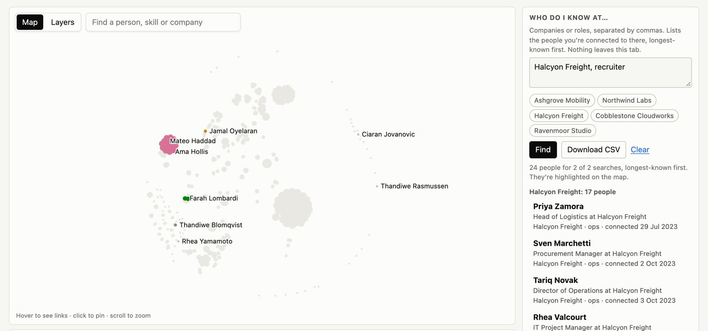

# Network Circles

Type a company or a role and see who you already know there, from your own LinkedIn data. Each person comes with the circle they belong to (the employer or the few days that put them in your network) and when you connected, so you can tell who to ask for an introduction. Everything runs in your browser tab or on your machine; your files are never uploaded.

**Try it:** [sample network](https://arak00.github.io/network-circles/web/) (300 fictional people) · [how to use your own data](https://arak00.github.io/network-circles/who/)

<picture>
  <source srcset="who/know-dark.png" media="(prefers-color-scheme: dark)">
  
</picture>

## What it does

- Search who you know. Companies, job titles, names, skills or events, separated by commas. Results come longest-known first, with each person's circle, and download as a CSV. This is the job that came out on top of the persona research in [research/findings.md](research/findings.md).
- Circles. Connections are grouped by shared current employer and by being added in the same few days. Generic employers such as "Freelance", "Self-employed" or "Stealth" don't link anyone. Each circle is tagged with what holds it together ("Same company", "Added around the same time", or "Company and timing"), and a circle held together by timing is named after the month, not a company, so testers can report which kind of circle is wrong without sharing their export. The export has no ties between your contacts, so circles are inferences; [docs/writeup.md](docs/writeup.md) explains how far to trust them.
- Three layouts of the same parts, switched at the top: List (results first, map beside them), Map (map large, search in a rail) and Circles (one card per circle). `?view=list|map|circles` picks the starting one, for usability sessions and comparisons.
- A map where nothing overlaps. Each circle is a disc of dots, oldest connection in the middle. Click a person to see their circle and what is tied to them alone (their organisation, the skills they endorsed, the events you connected around); the map never zooms away from the rest.
- Layers lines up your skills, organisations, events, groups and posts on either side of your circles.
- Timeline of when you connected. When most connections came in a few months, it says which months instead of drawing one spike.

Links: `web/?know=Acme,recruiter` opens the viewer with a search filled in, and `&own=1` waits for the visitor's files instead of showing the demo. [who/](who/) walks a visitor from requesting their LinkedIn data to their first search.

## Quick start

```sh
uv venv && uv pip install -r requirements.txt
# or: python -m venv .venv && .venv/bin/pip install -r requirements.txt
```

Request your data from LinkedIn (Me, Settings & Privacy, Data privacy, Download your data; pick the larger archive). For the command line, unzip it into a folder; the browser takes the zip as it is. Members in the EEA or Switzerland can also pull the same data through LinkedIn's DMA portability API, which needs no partner approval:

```sh
LINKEDIN_TOKEN=... python src/fetch_snapshot.py data/api    # setup steps are at the top of the script
```

The script writes export-style CSVs into `data/api/` and prints only row counts and column names. It never requests messages. Then either:

Run it from the command line and view the result:

```sh
python src/netmap.py <export_dir> results/private/graph.json
python -m http.server
# open http://localhost:8000/web/?data=../results/private/graph.json
```

The script prints counts only. It also writes `merges.csv` (the company spellings it merged) next to the output, so write into `results/private/`, which is gitignored.

Or skip the command line:

```sh
python -m http.server
# open http://localhost:8000/web/ and drop the zip LinkedIn sent you on the page
```

Opening `/web/` with no file shows the synthetic demo. Drop mode downloads the Pyodide runtime (about 10 MB) from jsDelivr the first time. You can pick the zip LinkedIn sends as it is: the viewer decompresses only the files it uses (with the browser's `DecompressionStream`) and never unpacks the rest, such as messages. Unzipped CSV files work too.

## Which export files are used

- `Connections.csv` (required): first and last name, current company, title and connected-on date.
- `Positions.csv` (optional): your own jobs. They become organisation nodes, and feed optional links that are off by default.
- `Invitations.csv` and `Recommendations_Received.csv` are loaded if present but don't affect the result yet.
- An optional `merge_overrides.csv` (`raw,canonical`) in the export folder corrects company merges.

These files add layers around the people. They don't change the circles.

| File | Layer | Linked to |
|---|---|---|
| `Skills.csv`, `Endorsement_Received_Info.csv`, `Endorsement_Given_Info.csv` | skills | the connections who endorsed you, or whom you endorsed |
| `Positions.csv`, `Education.csv`, `Company Follows.csv` | organisations | connections who work there now |
| `Events.csv` | events | connections you added in the 7 days after |
| `Shares.csv`, `Comments.csv` | posts | the hashtags and skills they mention (comments only when they mention one) |
| `Groups.csv` | groups | hashtags and skills in the group name |
| `Member_Follows.csv` | people you follow | flags connections; the rest hang off "You" |

`Reactions.csv` is only counted, since it doesn't say whose post you reacted to. LinkedIn gives no list of your followers, through the export or any API, so followers can't be shown. On the map, layer nodes appear around the circles for the person or item you point at. The Layers view puts each kind in its own column, ordered so that linked nodes sit at similar heights.

Messages are never read: `netmap.py` doesn't open `messages.csv`, and `fetch_snapshot.py` doesn't request the inbox. Email addresses and profile URLs from `Connections.csv` are not copied into the output. In the browser, CSVs other than the ones listed here are copied into the tab's memory and ignored.

## Privacy

- In the browser your files are read inside the tab and processed there. Nothing is uploaded, and `tests/journey_test.py` fails if any request the page makes carries data.
- `data/` and `results/private/` are gitignored. Keep your export and anything generated from it there.
- Never commit your export, a `graph.json` or `merges.csv` built from it, or screenshots with real names.
- The repo contains only the synthetic export in `demo/` and aggregate metrics in `results/metrics.json`.

## Validation

The clustering is checked against SNAP ego-Facebook circles, planted circles in the synthetic export, seed stability, two null models and a weight ablation. Checks against hand labels and outside testers are still pending. The full table, with the n, range and limits of each number, is in [docs/writeup.md](docs/writeup.md).

To regenerate the synthetic-data metrics:

```sh
python src/validate.py run none
```

This rewrites `results/metrics.json` with the hand-label section set to `pending`. Real-export aggregates only ever go to `results/private/metrics_real.json`. The SNAP section also stays `pending` unless you download `https://snap.stanford.edu/data/facebook.tar.gz` and extract it into `data/snap/`.

## Repo layout

```
src/netmap.py       pipeline: load, merge, affiliations, projection, Leiden, graph.json
src/fetch_snapshot.py  pulls your own data through the DMA portability API (EEA/Switzerland)
src/synth.py        seeded generator for the fictional demo export, layer files included
src/validate.py     validation, writes results/metrics.json (aggregates only)
web/                viewer (index.html, app.js, vendored sigma.js and graphology)
who/                showcase page: what the search does and how to get your own data
demo/               synthetic export, planted truth and its graph.json
tests/              synthetic test grid, layout invariants in a real browser, own-data journey, palette, screenshots
docs/               write-up, method diagram, usability test, tester form, design audit, layout mockups
research/           persona research: hypotheses, sourced evidence, findings, field-work kit
results/metrics.json
plans/              build plan
```

## Contributing and license

See [CONTRIBUTING.md](CONTRIBUTING.md). Released under the [MIT License](LICENSE).
